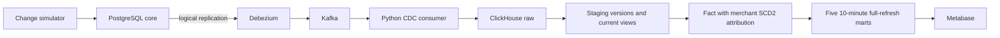

# Payment Analytics Data Platform

A local payment analytics demo: PostgreSQL is the transactional source, Debezium
and Kafka carry changes, and ClickHouse stores raw CDC, staging models, a
transaction-time analytical Fact and five reporting marts intended for Metabase
queries. Amounts are integer rials; source data is synthetic.

## Architecture



The simulator starts after the startup-readiness smoke checks pass. Design
rationale and tradeoffs are in [architecture.md](docs/architecture.md); table
grains and metric rules are in [data_dictionary.md](docs/data_dictionary.md).

## Prerequisites and setup

- Docker Engine and Docker Compose plugin.
- A machine with 16 GB RAM as specified by the assignment; actual peak resource
  use has not been independently measured here.
- For host-side reconciliation only: Python and the root `requirements.txt`.

Create the local environment file and set non-empty local passwords:

```sh
cp .env.example .env
```

Configure `POSTGRES_PASSWORD` and `CLICKHOUSE_PASSWORD` in `.env`; do not commit
that file. The other example values provide local ports and database/user names.

## Start and operate

```sh
docker compose up -d --build
docker compose ps -a
```

Wait until `startup-readiness` is healthy and `change-simulator` is running.
The readiness job checks seed counts, Kafka topics, Debezium task state,
ClickHouse staging/Fact counts and recent rows in all five marts. Metabase is
available at <http://localhost:3000>. Compose starts Metabase with its persistent
application database, but the repository does **not** provision saved questions
or dashboards; configure/import them separately. An empty Metabase volume will
not contain the assignment dashboard automatically.

Run the bounded readiness checks again with:

```sh
docker compose run --rm smoke-test
```

The simulator continuously inserts and updates transactions, reverses some
successes, changes a merchant's risk/province each minute, and creates/deletes
test transactions. Stop or restart it independently with:

```sh
docker compose stop change-simulator
docker compose start change-simulator
```

## Quality and reconciliation

Reconciliation compares PostgreSQL with ClickHouse. Stop source writes, then
wait for the consumer to catch up before running it; the flag is an operator
assertion and does not enforce quiescence:

```sh
docker compose stop change-simulator
docker compose exec kafka /opt/kafka/bin/kafka-consumer-groups.sh \
  --bootstrap-server kafka:9092 --describe \
  --group zibal-clickhouse-raw-v1
RECONCILE_QUIESCENT=1 python scripts/reconcile.py
docker compose start change-simulator
```

Install root Python dependencies first if needed:

```sh
python -m pip install -r requirements.txt
```

Reconciliation is one-shot; no daily scheduler is configured.
See [data governance](docs/data_governance.md) for the consistency boundary and
the distinction between routine checks and mutating SQL scripts.

## Limitations and evidence

Merchant snapshot values do not establish pre-capture risk/province history;
merchant event timestamps have millisecond precision. Kafka retention is seven
days, and reporting marts recompute fully every ten minutes. Benchmark timings
are owner-reported one-off observations; query equivalence and controlled gains
are unverified. The exact original assignment coverage is mapped in
[requirements_coverage.md](docs/requirements_coverage.md).
