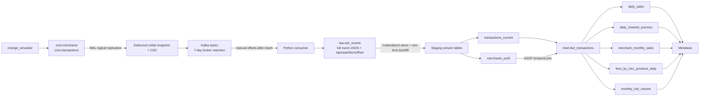
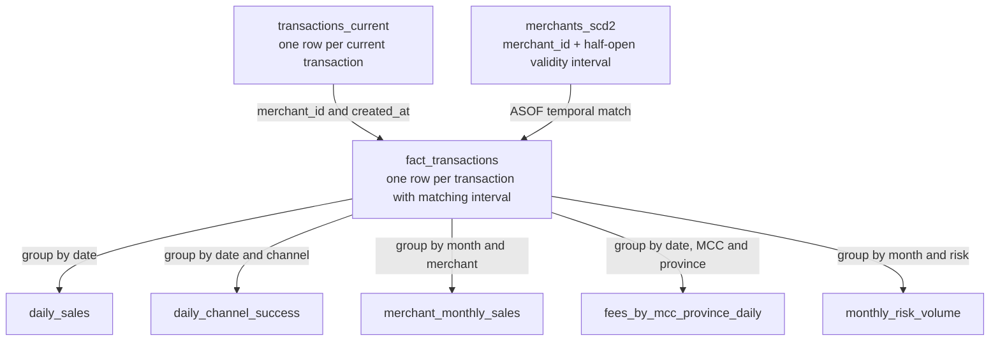

# Architecture and Implementation Decisions

This page records the decisions visible in the implementation. It is not a
historical decision log: alternatives below describe options not used in this
repository, not necessarily options formally evaluated at the time.

## Data flow and model

The source schema and connector are in `docker/postgres/init/01_schema.sql` and
`docker/debezium/register.py`. The CDC consumer is `cdc_consumer/main.py`;
ClickHouse model definitions are in `transformations/`. The marts are refreshable
materialized views with a full query refresh every 10 minutes.

See [data_dictionary.md](data_dictionary.md) for exact grains and metric
definitions.

## Decisions and tradeoffs

| Implementation choice | Repository-specific rationale and tradeoff |
|---|---|
| PostgreSQL source | Models the payment OLTP `core` schema and enforces source primary/foreign keys and allowed status/channel/risk values. It is also the baseline dashboard source described in the assignment. |
| Debezium PostgreSQL connector | Uses PostgreSQL logical replication (`pgoutput`) and an initial snapshot, then captures row changes. This avoids application-side polling but requires a replication slot and WAL capacity planning. |
| Kafka transport | Separates source capture from ClickHouse consumption and retains events for replay. The broker is single-node with seven-day retention and no configured ACL/TLS; it is a local demo choice, not a highly available deployment. Direct source-to-sink polling is not used. |
| Raw CDC before modeling | `raw.cdc_events` retains topic, partition, offset, operation, source LSN and the complete event JSON. This preserves replay/debug context and schema fields, but also retains sensitive source values and consumes storage. |
| Offset-based version identity | The consumer commits offsets only after ClickHouse accepts a batch. Delivery is at least once; raw and staging ReplacingMergeTree keys include the event's Kafka offset (and partition), allowing duplicate event identities to collapse. This does not make Kafka and ClickHouse one atomic transaction. |
| Transaction history plus current view | `transactions_versions` records CDC versions and tombstones; `transactions_current` chooses the greatest Kafka offset and excludes a latest delete. The view avoids rebuilding a separate current table, but evaluates version history when queried. |
| Merchant SCD2 history | The SCD2 view builds intervals from significant province, risk and delete changes, then Fact uses `created_at` for temporal attribution. Snapshot rows use a 1970 UTC sentinel because no pre-snapshot history is available. Debezium `source.ts_ms` has millisecond precision. Name/MCC-only changes are not currently versioned. |
| Incremental raw/staging ingestion | Staging materialized views process new raw inserts. Bootstrap creates those views before consuming Kafka and runs one guarded initial backfill with offset anti-joins. This limits repeated backfill work; ClickHouse views still compute current state and Fact from version tables. |
| Refreshable reporting marts | Five aggregates are precomputed every 10 minutes with full refresh queries. This keeps dashboard reads simple and fast, but refresh cost is excluded from query timings and may be material at five million rows on a 16 GB host. |
| Metabase application database | Compose persists Metabase's H2 application DB in a named volume. Saved cards/dashboards are not provisioned from repository files, so an empty Metabase volume requires separate setup/import. |

The design favors a small, locally reproducible assessment stack over HA or a
separate orchestration platform. Alternatives such as polling, direct writes
from PostgreSQL to ClickHouse, or an incremental aggregate-maintenance system
are not implemented; the repository contains no record that these were
formally benchmarked and rejected.

## Performance comparison boundary

The PostgreSQL dashboard is described by the assignment as querying `core`
directly. ClickHouse reports read pre-aggregated mart tables. The five latest
timings are owner-reported observations and exclude the recurring full-refresh
cost. Original baseline and saved question SQL are not versioned in the
repository, so exact metric equivalence cannot be independently confirmed.
See [benchmark.md](benchmark.md) for timings and caveats.
